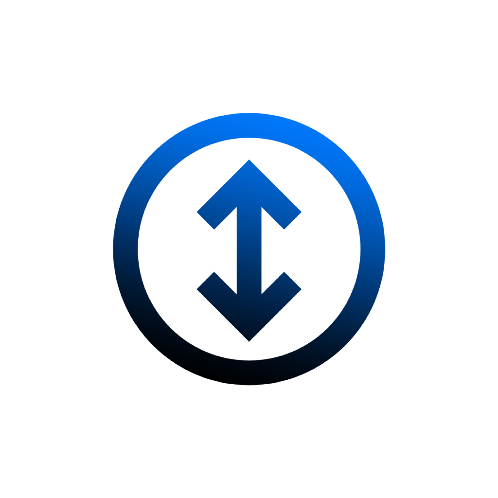

# Tipflow

[](https://github.com/Seven-hub-fanfan/Tipflow/releases)

A native macOS workspace for image-to-prompt analysis, mouse shortcuts,
auto-scrolling and cursor skins.



## Download

Download **[Tipflow v0.1](https://github.com/Seven-hub-fanfan/Tipflow/releases/tag/v0.1)**.
The `Tipflow-v0.1-universal.dmg` contains Apple Silicon and Intel binaries.
Drag **Tipflow.app** to Applications, then open it.

This preview uses an ad-hoc signature and has no Apple notarization. If macOS
blocks it, use **System Settings → Privacy & Security → Open Anyway**.
Deployment target: macOS 13 or later. Intel hardware and macOS 13/14/15 have
not been tested; a Universal binary does not certify every supported environment.

## Features

- **Image to prompt:** Native reference/result workspace with Chinese, English,
  JSON and negative prompts, streaming output, cancellation and Markdown export.
- **Multiple API connections:** OpenAI-compatible, Gemini and Anthropic protocols;
  presets for OpenAI, Gemini, Claude, Qwen, Volcano Engine, Zhipu, OpenRouter,
  local Ollama and custom endpoints. Use a model that supports images.
- **Image sources:** Local files, drag and drop, clipboard, direct image URLs and
  region capture. Open up to five images and analyze them sequentially.
- **Local history:** Search, favorites and reference restoration, with up to
  100 saved results. API keys are stored in macOS Keychain.
- **Click shortcuts:** Record up to ten keyboard combinations and execute one
  per mouse click, with configurable left/middle click, looping and saved progress.
- **Auto-scrolling:** Double middle-click by default; cursor movement controls
  direction and speed. Seven mouse activation methods and Option+trackpad scrolling.
- **Cursor skins:** System cursors, Nai Wa, Xiao Qi, bundled Doubao and seven
  Sweezy themes, with 13 static states, previews, favorites and size control.
- **Appearance:** Dark, light and system modes; native settings and draggable
  permission guidance.

## Permissions and privacy

Local image import and API analysis do not require Accessibility permission.
Region capture requires Screen Recording. Global scrolling and shortcuts need
Accessibility and Input Monitoring; configure them from **Permissions**.
Add the installed **Tipflow.app**. Rebuilding an ad-hoc signed application may
require granting its permissions again.

Image analysis sends a JPEG resized to a maximum 1600 px edge and your
instructions to the selected API. The original-file limit is 32 MB. Provider
fees and data policies apply. A local Ollama endpoint can keep analysis on your
Mac. History and reference copies stay in
`~/Library/Application Support/com.tipflow.app/PromptStudio/`.
Results describe visible features and cannot guarantee the original prompt.

Doubao ships offline. Other skins download on demand and work offline afterward.
Nai Wa and Xiao Qi download from this repository's v0.1 assets; Sweezy packages
come from the official site. Deleting an active download restores system cursors
first, and quitting restores original cursors. The global cursor engine uses
private macOS interfaces; application-drawn cursors may behave differently.

## Build

Install Xcode Command Line Tools, clone this repository and check out `v0.1`:

```bash
bash scripts/build_app.sh
bash scripts/create_dmg_from_app.sh
```

Outputs: `build/Tipflow.app` and `build/Tipflow-v0.1-universal.dmg`.
No Xcode project or third-party runtime dependencies are required.
See [build and validation scripts](scripts/README.md) and
[cursor resources](Tipflow/Skins/README.md).

## License and acknowledgements

[GNU General Public License v3.0](LICENSE).

Tipflow continues the native utility developed in
[Seven-hub-fanfan/scrollapp-leftclick](https://github.com/Seven-hub-fanfan/scrollapp-leftclick),
which is based on [fromis-9/scrollapp](https://github.com/fromis-9/scrollapp).
The original license and Git history are preserved. This repository uses the
Tipflow name and its own version sequence, starting at v0.1.
